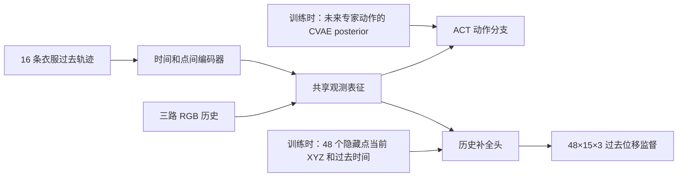

# 长袖叠衣服：历史轨迹补全辅助策略

**状态更新：增强模型现已实现，10 项专项测试通过；正式训练和闭环成功率尚未完成。** 实现及工程验收见 [flow-model.zh-CN.md](flow-model.zh-CN.md)。下文保留已确定的实验设计；机器可读约定见 [track_aux_design.json](track_aux_design.json)。研究问题是：在 RGB 历史和关节状态之外加入稀疏衣服运动，补全同一段过去运动的辅助监督是否改善动作学习。不是预测未来轨迹。

## 输入和计算路径

每个决策时刻使用最近 16 帧，每隔 3 个 90 Hz 物理步采样，跨度 0.5 秒。三路 RGB 和轨迹严格共享时间窗口。冷启动以有效性 mask 表示缺失，不能复制当前帧伪造历史。关节状态仍是实际测得的 12 维弧度读数。

先做 GT 上界：从当前三相机可见的衣服表面选择 64 个持久 mesh vertex，固定其身份回查历史；不包含夹爪点。从中随机选 K=16 个作为策略输入，剩余 48 个只用于辅助监督。全部位置用固定世界坐标、米；输入当前 XYZ、各过去时刻相对当前的位移、负相对时间与有效性 mask。所有空间量除以固定 0.5 m，不按每段目标轨迹计算归一化统计。GT 的遮挡期位置属于特权上界；有效性和可见性分开存储，不能把遮挡误称跟踪缺失。

轨迹先经过 2 层时间 Transformer，再经过 2 层点间 Transformer，宽度 256、4 heads，投影到 ACT 的 512 维。RGB 使用共享 ResNet18，每相机每帧池化为 4×4 tokens，加入相机和相对时间编码；所有正式对照都使用同一 RGB 历史、分辨率与归一化。共享观测 tokens 与当前关节状态进入 ACT，输出 100×12 的关节目标块，保留每 100 步重规划的初始对照设置。

辅助分支必须取自 **ACT CVAE 动作 posterior 之前**的共享观测表征。ACT 训练 posterior 会看到未来专家动作块，不能把该 latent 或被其调制后的动作 decoder 表征提供给历史补全头。正式模型需要自定义 history/token 接口；不能直接把原 ACT 的 n_obs_steps 改成 16 或把历史帧拼成 ResNet 通道。先产生 `B×S×512` 观测 tokens，再送 ACT 核心；点 ID 只用于历史对应，不作为语义 mesh-ID embedding。隐藏点当前坐标是辅助 decoder 的 query，只在训练时使用，不能进入 actor；预测出的补全轨迹也不回灌 actor。部署时删除整个辅助头。

联合训练 `L = L_ACT + 0.1 L_history`。L_ACT 保留 ACT 动作损失与 KL（权重 10）；L_history 为归一化位移的 masked SmoothL1，只统计 48 个隐藏点的 15 个过去时刻，排除当前时刻和无效位置，并按有效元素数归一化。记录共享编码器上两种损失的梯度范数；只用验证集决定是否调辅助权重。

## 正式对照

1. **RGB-H**：同样 16 帧 RGB 历史 + 当前关节状态；轨迹 context slots 用 mask/null tokens。
2. **RGB-H+Geometry**：额外给 16 个点的当前 XYZ，历史位移屏蔽。
3. **RGB-H+Tracks**：给 16 条过去轨迹，仅动作损失。
4. **RGB-H+Tracks+Completion**：与第 3 组完全相同的推理输入，训练增加历史补全损失。

第 2 对第 1 组分离额外三维几何，第 3 对第 2 组分离运动历史，第 4 对第 3 组分离补全监督。四组使用相同模型骨架/context slots、成对初始化、数据顺序和训练预算。建议每组 3 个种子（1000/1001/1002），30000 个 optimizer steps、有效 batch 16、lr/backbone lr 1e-5；从 microbatch 1、梯度累积 16 开始，先量内存，再决定 backbone 分块/checkpointing。额外报告参数量、训练资源和延迟，不能把等步数称为等算力。

当前公开 ACT 是单帧 RGB+关节，训练 provenance 未完整固定；它只验证管线和提供参考，**不能直接作为新训练轨迹模型的公平对照**。正式四组都需要在重新冻结的数据划分上训练。

## 数据与因果约束

从官方未合并源按“衣服 ID / 本地 episode / 初始 pose”明确对应，回放专家关节控制；同步重新渲染 RGB 并保存持久 mesh vertex、相机参数、每一物理步时间、可见性和控制。禁止用原录制 RGB 配另一场回放的 GT tracks。新数据规定 `obs[t] -> action[t] -> physics step -> obs[t+1]`；官方旧采集代码是 step 后读 observation，不能直接假定其时间标签等价。

先按衣服划分，再切窗口：Seen_0–7 训练、Seen_8 验证、Seen_9 离线测试；后续新冻结在线场景用 Seen_9、Unseen_0/1。当前 20 场景是开发评估，不再作为未看过的最终测试。记录源 revision、pose、scale、所有 RNG、相机投影、mesh 拓扑和 point ID，并做缓存 fingerprint。

GT 上界并不证明 RGB tracker 可部署。第二阶段 tracker 只能访问截至当前帧的观察前缀，不能先对整集视频双向跟踪后截取过去。需要用估计轨迹重新训练或微调，并模拟遮挡、漂移、丢点和 mask。RGB-only 阶段还必须具备因果的米制世界坐标三维估计；二维像素轨迹不能直接当 XYZ。不能悄悄使用仿真深度；如果使用观测深度，应明确改称 RGB-D 条件并增加匹配的 RGB-D 对照。

## 开始训练前必须实现的验收

验收要求如下；已执行项目及数值另见 [实现记录](flow-model.zh-CN.md)，不把尚未执行的正式训练当成结果：替换隐藏 target 不改变策略条件；替换未来专家动作不改变历史补全预测；替换辅助 query 不改变 actor 输出；持久点身份、时间与相机投影一致；tiny batch 能过拟合且辅助梯度到达共享编码器；无效/cold-start mask 正确；和“所有过去位置等于当前位置”的静态预测比较，并单独报告窗口最大位移超过 5 mm 的运动点误差。最终以闭环成功率及配对场景差值判断 policy 是否获益，不能仅凭补全误差下降得结论。

相关工作 [PointZero](https://pointzero-wm.github.io/) 已研究点轨迹补全及下游策略。这里需要验证的具体差异是**同一段过去运动的辅助表征学习**；泛称“轨迹补全帮助策略”不足以支持新颖性。
